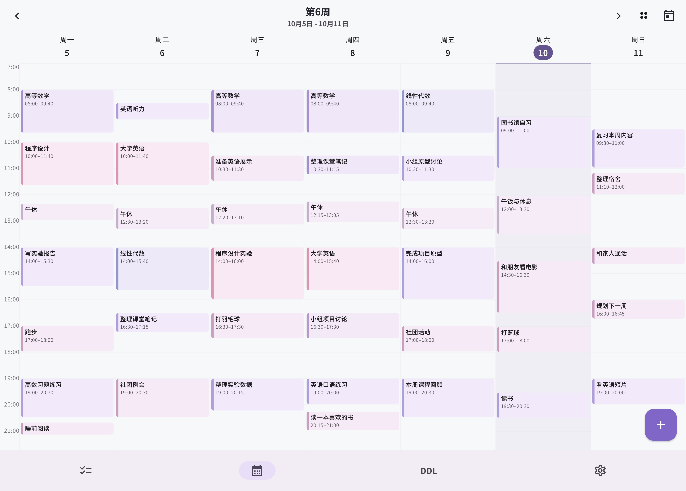
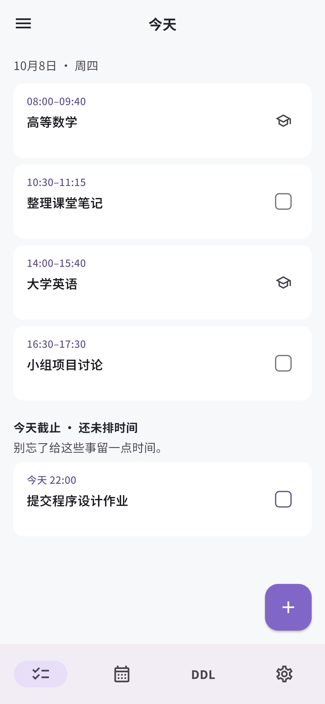
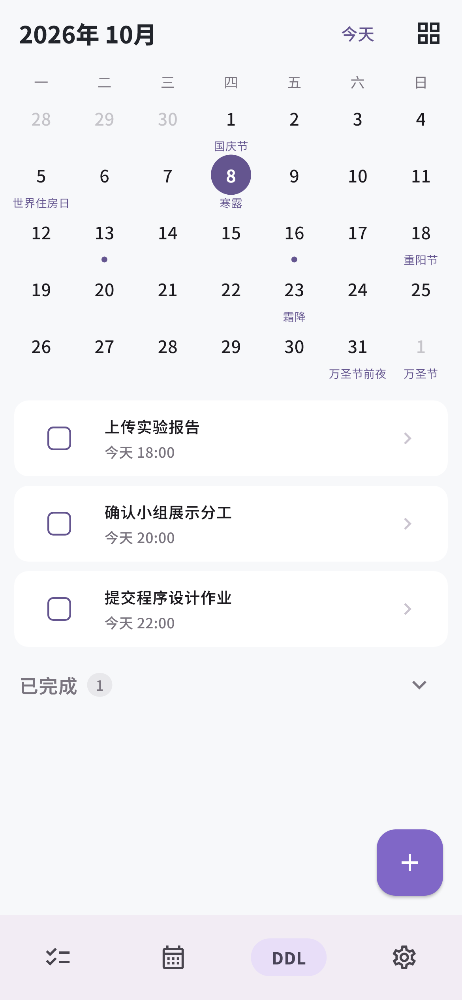
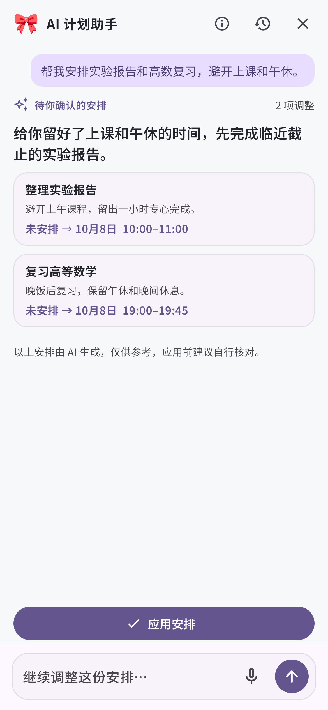

  

<h1 align="center">DDL Killer</h1>

<strong>Make time for what you want to do.</strong>

Built for university students in China: class timetables, deadlines, personal plans, and AI-assisted scheduling.

  
  
  

  <a href="https://app.ddlkiller.com"><strong>Open web app</strong></a> ·
  <a href="https://ddlkiller.com/download.html"><strong>Download Android</strong></a> ·
  <a href="https://ddlkiller.com">Website</a> ·
  <a href="https://ddlkiller.com/help.html">Help</a> ·
  <a href="README.md">简体中文</a>

## Make room for life around your classes

A timetable lives in the university portal, assignments in a checklist, and personal plans somewhere else. Planning a day means bringing these together: **when do I have classes, what is due soon, and what time can I keep for myself?**

DDL Killer starts with this everyday problem for university students in China. Imported classes and personal plans share one timeline. Tasks can have a deadline, a scheduled time, or both. **Alice 🎀**, the AI planning assistant, considers courses, deadlines, and existing plans, then offers a draft for you to review, adjust, and confirm.

  

<em>Your classes, tasks, and life in one week.</em>

## From a task list to a workable plan

| What you need | How DDL Killer helps |
| --- | --- |
| Stop comparing your timetable with a separate planner | Import a semester timetable and view classes alongside personal time blocks. |
| Remember to make time for an approaching deadline | Organize tasks and due dates; Today separately highlights tasks due today that have no scheduled time. |
| Find a starting point when there is too much to do | Describe tasks and preferences to Alice, preview new tasks or scheduling changes, check them against classes, and confirm. |
| Use a model or agent you already prefer | Configure your own API key, or connect your own agent through MCP. |
| Work on both a computer and a phone | Sync Web and Android. Enable offline data on a device to view and edit cached content, then sync after reconnecting. |

  
  
  

<strong>Today · Deadlines · Alice</strong> Rendered from actual UI components with entirely fictional demo data. The AI conversation is scripted for the demonstration. Click an image to enlarge it.

The application interface is currently in Chinese. AI suggestions are for reference; review them before applying. Offline support covers cached application data. Initial login, AI, email, and cloud features require a network connection.

## Bring your university timetable

The repository currently provides export scripts and [user instructions](https://ddlkiller.com/kebiao-help.html) for **Shandong University** and **Harbin Institute of Technology, Shenzhen**. Compatibility depends on campus, portal version, and semester; see the [adapter scope and limitations](docs/school-timetable-export.md#当前有哪些实现可参考).

If your university is not covered, contributions are welcome. Follow university rules and use only data the user is authorized to access. Convert it into the common JSON format to reuse timetable import, calendar views, and class-aware AI planning.

The [timetable exporter tutorial](docs/school-timetable-export.md), [fictional sample timetable](docs/examples/timetable-demo.json), and [offline validator](docs/examples/validate-timetable-demo.mjs) explain data sources, semester dates, week ranges, period mapping, tests, and contribution requirements. Start with a clearly defined campus and workflow. Submit fictional fixtures, never university credentials, cookies, or personal timetables.

## Build your own project with it

We welcome developers who want to reuse this foundation: build a personal planner, explore AI scheduling, or improve the timetable experience for their own university.

- **Add a university adapter:** transform timetable data and reuse the existing client and calendar.
- **Improve a campus timetable experience:** adapt course details, week views, or free-time displays to local needs.
- **Build a planner or AI tool:** study task scheduling, offline sync, availability calculation, draft validation, and confirmation.

The [developer and reuse guide](docs/developer-guide.md) covers architecture, source entry points, data relationships, and these three routes. This repository is a complete application, not a packaged SDK. Extracting modules requires handling their data, authentication, and sync dependencies. Follow the license and clearly identify your own version and maintenance team.

## Where to go next

Most detailed guides are currently in Chinese.

| Goal | Resources |
| --- | --- |
| Start using the app | [Web app](https://app.ddlkiller.com) · [Android download page](https://ddlkiller.com/download.html) · [Help](https://ddlkiller.com/help.html) |
| Use your own model | [API key setup](https://ddlkiller.com/api-key-help.html); connect MCP in application settings |
| Understand or reuse the code | [Developer guide](docs/developer-guide.md) |
| Export your university timetable | [Exporter development tutorial](docs/school-timetable-export.md) |
| Run your own instance | [Self-hosting](docs/self-hosting.md), including initial account, builds, email, AI, and MCP |
| Contribute or report a problem | [Contributing](CONTRIBUTING.md) · [Tests and CI](docs/ci.md) · [Security](SECURITY.md) |

The backend uses **Node.js 24 + SQLite**, and the client uses **Flutter / Dart**. The MCP gateway is in `mcp-server/`; the website and help pages are in `website/`. See the developer guide for source navigation. Use the dependency constraints and committed lockfiles.

Stable and Beta environments keep separate data. Choose stable for regular use; develop with your own test environment and fictional data.

## Free application, limited introductory AI allowance

**DDL Killer charges no software usage fees.**

The official free AI allowance lets new users try the assistant and decide whether it suits them. These AI calls increase our operating costs, so the allowance may change with costs and service conditions. For continued use, we recommend your own API key or an agent connected through MCP. Third-party model or agent services charge under their own terms.

Anyone charging software usage fees in the name of the official DDL Killer project is not acting on our behalf; do not pay them. Third-party services based on this source must identify themselves clearly. Their pricing does not represent official charges.

## License and branding

Copyright (c) 2026 Andy233.

Original project code is licensed under the [GNU Affero General Public License v3.0](LICENSE), SPDX **`AGPL-3.0-only`**. Follow its corresponding-source and other requirements when reusing, modifying, distributing, or serving a modified version over a network. Commercial use is permitted.

Third-party dependencies and fonts retain their own licenses; see [third-party notices](THIRD_PARTY_NOTICES.md). Use of the project name or logo must not imply official operation or endorsement of a third-party version or service.
