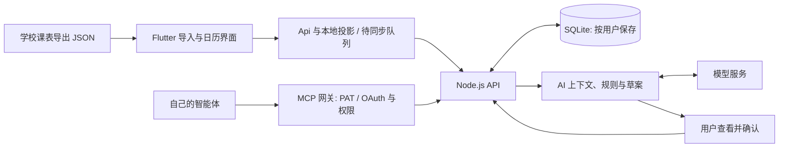

# 开发与复用指南

DDL Killer 从中国大学生的日常安排出发：课表决定一周里哪些时间已经被占用，作业、考试、社团和个人计划则需要在剩余时间里找到位置。项目把课程、任务清单、DDL 和日历放在同一套数据与界面中，再让 AI 根据这些信息提出可查看、可调整、由用户确认的安排。

欢迎用现有代码做自己的计划工具、改善本校课表的查看体验，或贡献学校课表导出适配。这里介绍当前代码怎样运行，以及从哪里改起。仓库是一套可运行的应用，尚未整理为可直接安装的通用 SDK；下面的源码路径是阅读入口，接口和表结构仍可能随版本演进。

## 先跑通一个小流程

先按 [自部署说明](self-hosting.md) 建立自己的测试实例。用空数据库创建账号，添加一项虚构任务，为它安排时间，再导入一份虚构课表。先观察课程和任务怎样出现在同一天，比一开始阅读所有文件更容易理解项目。

可按目标选择入口：

| 你想做什么 | 从哪里开始 |
| --- | --- |
| 让本校同学导入自己的课表 | [课表导出脚本开发教程](school-timetable-export.md)，以及下文的路线一 |
| 改课表、今天安排或日历界面 | [客户端入口](../app/lib/main.dart)、[主界面](../app/lib/screens/root_screen.dart)、[周视图](../app/lib/screens/week_screen.dart) |
| 扩展任务、排期或 AI | [API 组装](../backend/src/app.js)、[任务排期](../backend/src/task-planning.js)、[AI 会话](../backend/src/ai-sessions.js) |
| 接入自己的智能体 | [公共 MCP 网关](../mcp-server/public/server.mjs)、[工具定义](../mcp-server/public/tools-read.mjs)和下文的 MCP 流程 |

参与上游开发前阅读 [贡献说明](../CONTRIBUTING.md)。运行命令和检查范围见 [CI 说明](ci.md)；实际部署配置以 [自部署说明](self-hosting.md) 为准。

## 代码怎样连接起来

图中的 AI 草案保存在服务端。生成建议和确认写入是两次不同操作；模型输出不会直接成为数据库写入语句。

建议先阅读以下文件，再按改动范围深入：

| 文件 | 解决的问题 |
| --- | --- |
| [app/lib/api.dart](../app/lib/api.dart) | 客户端请求入口、账号状态、离线读写分流，以及业务 API 方法 |
| [app/lib/models.dart](../app/lib/models.dart) | 任务、清单、课程和时间轴的客户端表示 |
| [app/lib/plan_bus.dart](../app/lib/plan_bus.dart) | 数据改变后，通知常驻页面刷新 |
| [backend/src/app.js](../backend/src/app.js) | Express 路由组装，以及课表、日历、清单等基础接口 |
| [backend/src/db.js](../backend/src/db.js) | SQLite 表结构与已有数据库的增量迁移 |
| [backend/src/schedule.js](../backend/src/schedule.js) | 把学期课表展开为某一天实际上的课程 |
| [backend/src/task-planning.js](../backend/src/task-planning.js) | 创建、编辑任务时，同步维护关联的排期块 |
| [app/lib/offline_sync.dart](../app/lib/offline_sync.dart) / [offline_projection.dart](../app/lib/offline_projection.dart) | 本机操作队列、离线界面投影、恢复联网和冲突处理 |
| [backend/src/offline-sync.js](../backend/src/offline-sync.js) | 用户快照、操作去重、冲突检查和同步回放 |
| [backend/src/ai-sessions.js](../backend/src/ai-sessions.js) | AI 会话、模型调用、要求收集和草案生成 |

## 先理解四类数据

| 数据 | 保存位置 | 与其他数据的关系 |
| --- | --- | --- |
| 清单 | `lists` 表 | 按用户保存；任务可通过 `list_id` 归属清单。已完成、回收站是按状态归集的入口，不能当普通清单写入。 |
| 任务 | `inbox` 表 | 保存标题、优先级、备注、截止日期、预计用时和完成状态；有 DDL 不代表已经安排时间。 |
| 日历时间块 | `blocks` 表 | 保存某日的起止分钟。`inbox_id` 有值时是任务排期，无值时是独立日程。当前每个任务最多关联一个时间块。 |
| 学期课表 | `schedules` 表的 `json` 列 | 每用户一份，导入会替换该用户的整份课表；课程按周次和星期计算，不逐节写成 `blocks`。 |

例如，一项“完成练习”的任务可以有周五的截止日期、60 分钟预计用时，再关联周三晚上的一个时间块。周三的课程从学期课表展开，和这个时间块一起显示；课程本身不会因勾选任务完成而变化。

数据库里还保存会话、AI 设置、草案、提醒和 MCP 授权等数据，详见 [db.js](../backend/src/db.js) 及对应功能模块。日期一般用 `YYYY-MM-DD`，日内时间用整数分钟；提醒时刻另用时间戳字符串。现有使用场景与默认时区围绕中国大学生日常安排，跨时区应用需要另行审阅日期与提醒逻辑。

### 课表从导入到显示

1. 学校适配脚本输出统一 JSON，用户在 [schedule_import_screen.dart](../app/lib/screens/schedule_import_screen.dart) 选文件、粘贴或拖入。
2. [Api.importSchedule](../app/lib/api.dart) 写入 `PUT /api/schedule`。启用离线数据后，这一步先进入本机队列，界面可以先看到本地结果；最终是否已写入服务端，以同步状态为准。
3. 服务端使用登录会话中的 `req.user.uid` 保存课表。`GET /api/schedule` 返回该用户的课表。
4. [getDayClasses](../backend/src/schedule.js) 根据 `semester_start`、星期、`slots[].weeks` 和节次映射展开课程。`GET /api/day?date=...`、`GET /api/days?start=...&count=...`、`GET /api/week?start=...` 将课程和用户的时间块合并后返回。
5. 离线时，[offline_projection.dart](../app/lib/offline_projection.dart) 从本地快照计算对应视图。因此改课表时间语义时，也要同步审阅客户端投影。

当前课表时间由 `period_to_block` 将小节映射到大节，再从 `period_times` 取该大节的起止时间；不能假设 JSON 中任意两个小节组合都能自动得到正确时段。完整格式、适配限制和虚构示例见 [导出教程](school-timetable-export.md)。客户端和后端的导入检查都不是完整的 JSON Schema 校验，适配者还需要验证周次、时间、空字段及节次映射。

### 任务与离线同步

客户端通过 `POST /api/inbox`、`PATCH /api/inbox/:id` 等接口表达操作；任务的 `schedule` 字段由 [saveTask](../backend/src/task-planning.js) 维护关联时间块。取消排期与删除任务是不同操作，二开时不要只删界面上的时间块而留下不一致的任务状态。

登录后，客户端先取 `GET /api/sync/snapshot`，其中包含该用户的清单、任务、时间块、课表和基础资料。可离线处理的操作会连同原始内容 `base`、操作 ID 一起排队，再提交 `POST /api/sync/mutation`。服务端按用户和操作 ID 去重，检查相同内容是否已被别的设备修改，然后复用业务路由执行；冲突会交给用户处理，不直接覆盖远端。

Web 的本地数据使用 Sembast Web / IndexedDB，原生客户端使用应用支持目录中的 Sembast 文件，入口分别是 [offline_database_web.dart](../app/lib/offline_database_web.dart) 和 [offline_database_native.dart](../app/lib/offline_database_native.dart)。这里的“离线”指已缓存业务数据及本地编辑，不是离线运行大模型。首次登录、AI、邮件和 MCP 仍需要联网。

新增可编辑字段或资源时，通常要一并检查数据库迁移、业务路由、快照、同步允许列表、本地投影和界面。仅在服务端加字段，可能造成在线显示正确、离线编辑后丢失或冲突判断遗漏。

### AI 怎样生成并应用安排

客户端的 [ai_planner_sheet.dart](../app/lib/screens/ai_planner_sheet.dart) 发起会话。服务端流程是：

1. [ai-planner.js](../backend/src/ai-planner.js) 从当前用户的未完成任务、已有时间块、课程及偏好构造上下文和空闲时段。
2. [ai-provider-client.js](../backend/src/ai-provider-client.js) 请求模型服务，返回结构化建议；[ai-requirements.js](../backend/src/ai-requirements.js) 处理本次明确要求。
3. 建议经过格式、对象归属与 [ai-plan-rules.js](../backend/src/ai-plan-rules.js) 的课程冲突、截止时间、时长和可用时段检查，再保存草案。当前内置助手支持安排或取消已有任务排期、新建任务及新建独立日程；不支持直接修改课程或把一个任务拆成多个排期块。
4. 用户在 [ai_draft_preview.dart](../app/lib/widgets/ai_draft_preview.dart) 查看并选择变更、确认要求后，调用 `POST /api/ai/drafts/:id/apply`。服务端会重新检查当前状态和规则，再在事务中写入。
5. [ai-draft-actions.js](../backend/src/ai-draft-actions.js) 保存应用前后的相关状态，支持 `POST /api/ai/applications/:id/undo`。相关内容随后被改动时，撤销可能被拒绝，不能把它理解为任意历史版本恢复。

创建会话的接口是 `POST /api/ai/sessions`，继续讨论用 `POST /api/ai/sessions/:id/turns`。客户端在生成、应用和撤销前通过 [ai_calendar_guard.dart](../app/lib/ai_calendar_guard.dart) 确保本机日历修改已同步，避免模型基于旧日程规划。自定义客户端也应保留这个前提。

模型 Key 在后端加密保存并由后端调用，相关实现是 [ai-credentials.js](../backend/src/ai-credentials.js) 与 [ai-provider-url.js](../backend/src/ai-provider-url.js)。当前自定义模型地址要求公网 HTTPS；本机 Ollama 或内网端点不能直接按现有配置接入。配置自己的模型、密钥与预算见 [自部署说明](self-hosting.md)。

### 自己的智能体怎样接入

公共入口为 [mcp-server/public/server.mjs](../mcp-server/public/server.mjs) 的 `/mcp`，使用 PAT 或 OAuth。网关验证凭据后，通过 [api-client.mjs](../mcp-server/public/api-client.mjs) 访问后端；它不直接读数据库。

工具分别定义在 [tools-read.mjs](../mcp-server/public/tools-read.mjs)、[tools-write.mjs](../mcp-server/public/tools-write.mjs) 和 [tools-drafts.mjs](../mcp-server/public/tools-drafts.mjs)。权限包括 `mcp:read`、`mcp:tasks:write`、`mcp:schedule:draft`、`mcp:schedule:apply`、`mcp:delete` 和 `mcp:purge`，按用户授予的权限开放工具。外部智能体做自主排期时可以先创建、查看草案，再单独应用；授予应用权限意味着客户端能发起应用操作，不等于服务端能判断人是否真的看过预览，智能体侧仍需实现用户确认。

内置 AI 和 MCP 共享 [mcp-drafts.js](../backend/src/mcp-drafts.js) 的草案基础，但两者的操作集合和确认规则并不完全相同。例如公共 MCP 草案没有内置 AI 的 `create_task` 操作，创建任务使用任务工具。不要把内置 AI 的接口直接当作 MCP 工具协议。

`mcp-server/server.mjs` 是旧的账号密码集成，新的第三方接入应从 `public/` 目录开始。`/api/internal/*` 仅用于内部通信，部署时应由反向代理阻止外部访问，具体配置见 [自部署说明](self-hosting.md)。

## 三条现实的二开路线

### 路线一：给自己的学校增加课表导出

适合希望让本校同学方便导入课表、但暂时不想改客户端的人。先完成一个遵守学校规定、在本人有权访问的页面上导出本人课表的适配器，将学校字段转换为统一 JSON，便可复用现有导入、日历、离线查看和 AI 避课流程。

从 [课表导出脚本开发教程](school-timetable-export.md) 开始，参考 [已有脚本目录](../app/web/userscript/)。无需为每所学校添加数据库表，也不必让 DDL Killer 收集教务账号密码。新适配至少提供：脚本、适用页面与学期选择说明、全部虚构的输入夹具及预期 JSON、节次和单双周边界测试。

验收应走完“导出 → 导入 → 指定周课程 → 每日安排”的完整流程，而不只是检查 JSON 能解析。新学校的节次、跨校区时间或调休方式超出现有模型时，先说明限制；涉及数据格式演进的改动应同时讨论服务端展开、离线投影和兼容方式。

### 路线二：改善本校的课表查看与安排体验

适合想做更贴近本校作息的课表入口、课程详情、空闲时段展示，或改进手机查看体验的人。可以保留账号、任务、导入和同步，从 [course_grid.dart](../app/lib/widgets/course_grid.dart)、[course_details_sheet.dart](../app/lib/widgets/course_details_sheet.dart)、[week_view.dart](../app/lib/widgets/week_view.dart) 和 [timeline_layout.dart](../app/lib/widgets/timeline_layout.dart) 开始。

只调整呈现时，尽量继续使用 `TimelineItem` 和现有课程展开结果。涉及上课时间、周次或补课语义时，同时修改 [schedule.js](../backend/src/schedule.js) 和 [offline_projection.dart](../app/lib/offline_projection.dart)。现有课表按学期起始日加周次计算，不含通用的校历调休引擎；“改善本校体验”可以先从一个有明确边界的小功能开始。

最小交付可以是：同一份虚构课表在手机和电脑上更易读，课程详情信息完整，任务与课程重叠时仍能正确操作。验证浅深主题、长课程名、不同节次、空周和离线重进；不要为了截图上传真实师生信息或个人课表。

### 路线三：做自己的计划工具或 AI 安排助手

适合课程之外还想整合项目、考试复习、社团或个人事务的人。可以 fork 完整应用保留账号与同步，也可以在自己的应用中复用任务排期、空闲时段计算、草案校验等实现；抽取时需要一起处理其数据库与认证依赖，目前这些文件不是独立组件包。

传统计划工具可以从 [task-planning.js](../backend/src/task-planning.js)、[task_editor.dart](../app/lib/widgets/task_editor.dart)、[task_planning_controls.dart](../app/lib/widgets/task_planning_controls.dart) 起步。AI 路线可从 [ai-availability.js](../backend/src/ai-availability.js)、[ai-planner.js](../backend/src/ai-planner.js)、[ai-plan-rules.js](../backend/src/ai-plan-rules.js) 和 [ai-draft-actions.js](../backend/src/ai-draft-actions.js) 开始；也可通过公共 MCP 用自己已有的智能体生成方案。

优先保留“读取本人数据 → 生成草案 → 校验 → 用户确认 → 应用”的过程。新增动作如拆分任务、批量修改截止日期或编辑课程，需要明确扩展模型输出、服务端规则、草案预览、执行与撤销，而不只是增加一句提示词。可先做一个范围有限的功能，例如根据预计用时和课程空档安排本周复习，并说明排不下时怎样向用户反馈。

## 复用时要一起保留的约定

- **用户归属来自会话。** [security.js](../backend/src/security.js) 验证 Cookie 或 Bearer 会话，业务查询使用 `req.user.uid`。客户端传来的对象 ID 不能证明所有权；新增读取、写入、关联和导出都应检查用户归属，覆盖两个测试账号之间的隔离。
- **数据库与本地数据是两个实现。** 改任务、课表或日期逻辑时检查同步和离线投影；新增资源不会自动获得离线支持。
- **AI 结果还要经过业务规则。** 模型的结构化输出、界面预览与服务端重新校验各有作用；继续保留过期草案、日程变化和重复应用的处理。
- **日历写入不一定等于任务写入。** 关联任务的排期与独立日程要分别处理，避免完成、删除和恢复时状态分叉。

## 哪些部分需要为自己的实例适配

以下功能可以参考和复用，但默认值包含上游产品或部署约定，独立发行前应主动审阅：

| 部分 | 适配入口 |
| --- | --- |
| API 来源与正式/Beta 分流 | [api.dart](../app/lib/api.dart)、[build_channel.dart](../app/lib/build_channel.dart)。Web 默认同源；Android 需设置自己的 `API_BASE`，Beta 构建另有来源规则。 |
| 更新、下载和帮助链接 | [app_updates.dart](../app/lib/app_updates.dart)、[app/web/app-update.json](../app/web/app-update.json)、[MCP 连接界面](../app/lib/screens/mcp_connections_screen.dart)、[课表导入界面](../app/lib/screens/schedule_import_screen.dart)。仅改 `API_BASE` 不会替换这些入口。 |
| 部署和旧课表迁移 | 根目录 [Compose](../docker-compose.yml) 与 [Caddy](../Caddyfile) 是独立本机示例；官方生产部署脚本不随源码发布。[index.js](../backend/src/index.js) 仍保留旧文件课表初始化逻辑；采用 [自部署模板](self-hosting.md) 的独立数据和配置。 |
| 发信与托管 AI | [email-service.js](../backend/src/email-service.js)、[ai-settings.js](../backend/src/ai-settings.js)、[ai-quota.js](../backend/src/ai-quota.js)。邮件当前接腾讯云 SES，托管额度由部署者配置并承担。 |
| 反馈、邀请和管理机器人 | [community.js](../backend/src/community.js)、[ai-invites.js](../backend/src/ai-invites.js)、[invite-bot/](../invite-bot/)。它们是产品运营功能，通常不是改课表或任务排期的起点。 |
| 数据保留和隐私说明 | [retention.js](../backend/src/retention.js) 的清理时限，以及 [privacy_policy_text.dart](../app/lib/privacy_policy_text.dart) 与 [官网隐私页](../website/privacy.html)。独立实例需根据自己的实际行为审阅。 |
| 品牌、包名和签名 | Flutter 资源、Android 配置及官网内容。独立发行使用自己的签名、应用标识和更新渠道，并清楚标识自己的维护身份。 |

请使用自己的部署配置、测试环境和数据，不要以维护者的生产环境作为开发服务。独立实例的完整启动步骤、已知限制和备份方法均见 [自部署说明](self-hosting.md)。

## 验证与贡献

修改前先找到相关测试：

| 改动 | 现有验证入口 |
| --- | --- |
| 任务与课表计算 | [backend/test/planning.test.js](../backend/test/planning.test.js)、[schedule.test.js](../backend/test/schedule.test.js) |
| 离线同步和冲突 | [backend/test/offline-sync.test.js](../backend/test/offline-sync.test.js)、[app/test/offline_sync_test.dart](../app/test/offline_sync_test.dart)、[offline_projection_test.dart](../app/test/offline_projection_test.dart) |
| AI 计划与确认 | [backend/test/ai-plan-rules.test.js](../backend/test/ai-plan-rules.test.js)、[ai-draft-actions.test.js](../backend/test/ai-draft-actions.test.js)、[ai-new-tasks.test.js](../backend/test/ai-new-tasks.test.js) |
| MCP 工具与权限 | [mcp-server/test-public.mjs](../mcp-server/test-public.mjs)、[backend/test/mcp-drafts.test.js](../backend/test/mcp-drafts.test.js)、[mcp-credentials.test.js](../backend/test/mcp-credentials.test.js) |

后端在 `backend/` 运行 `npm test`，客户端在 `app/` 运行 `flutter test`。按改动范围补有意义的验证，具体环境和其他工具检查见 [CI 说明](ci.md)。学校适配脚本还应使用虚构页面夹具测试解析，现场验证由有权访问该校系统的贡献者完成；不要提交真实账号、Cookie、课表、数据库或模型 Key。

欢迎贡献一个新学校适配、一个小的课表体验改进，或一段让下一位开发者更容易上手的说明。提交时写清适用范围、运行方法、已验证内容与限制，遵循 [贡献说明](../CONTRIBUTING.md)；安全问题使用 [安全反馈说明](../SECURITY.md) 中的私下渠道。

原创代码采用 `AGPL-3.0-only`。复用、修改、分发或通过网络提供修改版时，请遵守 [LICENSE](../LICENSE) 对对应源码等事项的要求；第三方依赖和素材见 [THIRD_PARTY_NOTICES.md](../THIRD_PARTY_NOTICES.md)。基于项目开发自己的产品时，清楚标识自己的版本与维护者，避免让使用者误认成 DDL Killer 官方服务。
